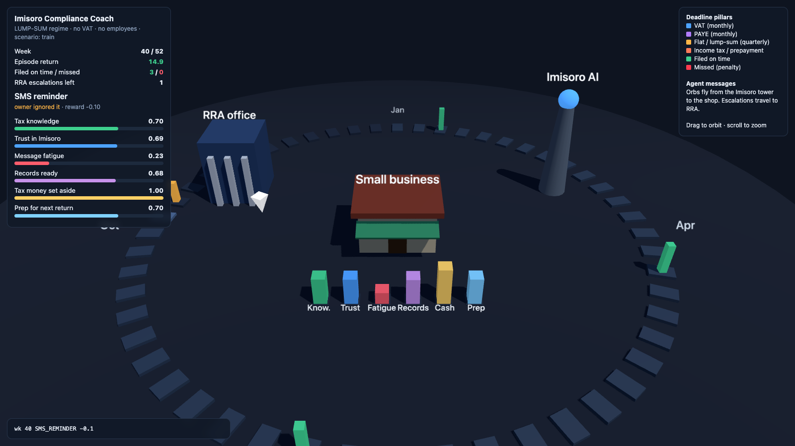

# Imisoro Compliance Coach — RL Summative

Reinforcement-learning component of the **Imisoro AI** capstone: a bilingual (Kinyarwanda/English)
RAG tax assistant for small businesses in Rwanda. This project trains the assistant's
**engagement policy**: each week of a tax year it decides whether and how to contact a small
business owner (SMS reminder, email digest with calendar, tax calculator, Kinyarwanda lesson,
record-keeping nudge, savings nudge, RRA escalation or nothing). The goal is to maximise on-time
RRA filings and payments without overloading the owner until they opt out.

Four TorchRL agents are compared on the same environment: **DQN**, **REINFORCE**, **PPO** and **A2C**.



## Quick start (uv only)

```bash
git clone https://github.com/Burabyo/jburabyo_rl_summative.git
cd jburabyo_rl_summative
uv sync
uv run main.py            # plays the best trained agent: opens the 3D view + verbose terminal log
```

| Command | What it does |
|---|---|
| `uv run main.py` / `uv run play.py` | Best overall agent in the 3D simulation (2 episodes) |
| `uv run main.py play --algo dqn --episodes 3 --fps 2` | Best model of one algorithm |
| `uv run main.py play --scenario stress` | Unseen, harder owner population (generalisation) |
| `uv run main.py random` | Random agent (shows the environment without a trained model) |
| `uv run main.py train --algo ppo` | Train one algorithm with default hyperparameters |
| `uv run main.py sweep` | 12 hyperparameter runs × 4 algorithms + seed-robustness re-runs |
| `uv run main.py plots` | Regenerate report figures and tables in `assets/` |
| `uv run main.py serve` | JSON inference API (see below) |
| `uv run pytest` | Environment tests (Gymnasium API checker, terminal conditions, determinism) |

The 3D view is a Three.js page served from `http://127.0.0.1:8765`. It loads Three.js from a
CDN, so the first load needs internet access.

## Environment (`environment/custom_env.py`)

* **Episode:** one tax year, 52 weekly steps, for one sampled business profile (regime:
  flat, lump-sum or real; VAT registration; employees). The profile sets the RRA obligation
  calendar: monthly VAT/PAYE (15th), quarterly flat/lump-sum declarations, annual return and
  quarterly prepayments.
* **Actions (8, discrete):** `WAIT, SMS_REMINDER, EMAIL_DIGEST, RUN_CALCULATOR, EDUCATION_MODULE,
  RECORDS_NUDGE, SAVINGS_NUDGE, ESCALATE_TO_RRA`.
* **Latent persistent state:** tax knowledge, trust in the assistant, message fatigue, record
  readiness, tax money set aside, preparation for the next return.
* **Observation (21 values in [0, 1]):** calendar features, profile, app-side signals
  (calculator progress, records score, savings tracker, engagement rate, recent contacts, quiz
  score), missed filings and escalations left.
* **Reward:** +10 for a return filed and paid on time, +4 if filed but underpaid, −15 for a missed
  deadline, small per-action costs (escalation −2), −25 if the owner opts out (terminal), and a
  year-end knowledge bonus.
* **Terminal / truncation:** the owner opts out when fatigued (terminated); the year ends at week 52 (truncated).
* **Scenarios:** `train` and `stress`. Stress owners are less knowledgeable, trust less and tire
  faster; they're used only for evaluation.

## Repository layout

```
environment/  custom_env.py (Gymnasium env) · rendering.py (live server + API) · web/index.html (Three.js)
training/     dqn_training.py · pg_training.py (REINFORCE, PPO, A2C) · sweep.py · plots.py · common.py
models/       dqn/ and pg/: every sweep run (.pt state_dict, .ts TorchScript, .json config+eval); *_best.*; best.json
logs/         per-run training CSVs, sweep_results.csv, seed_robustness.csv
assets/       report figures and tables
tests/        environment tests
```

## Integration / serialization

Each trained policy is saved three ways: as a PyTorch `state_dict` (`.pt`), as a TorchScript
module (`.ts`) that can be loaded without the training code, and as a `.json` file with its
config and evaluation results. `uv run main.py serve` exposes the best policy as an HTTP endpoint
that a web or mobile client can call:

```bash
curl -X POST http://127.0.0.1:8765/api/recommend -d '{"observation": [0.1, 0.25, 0.33, 1, 0, 0, 0, 0, 0, 1, 1, 1, 0.6, 0.2, 0.4, 0.1, 0.5, 0.25, 0.3, 0, 1]}'
# {"action_id": 7, "action": "ESCALATE_TO_RRA", "scores": [...]}   (deadline in 2 weeks, low knowledge, early in the year)
```
